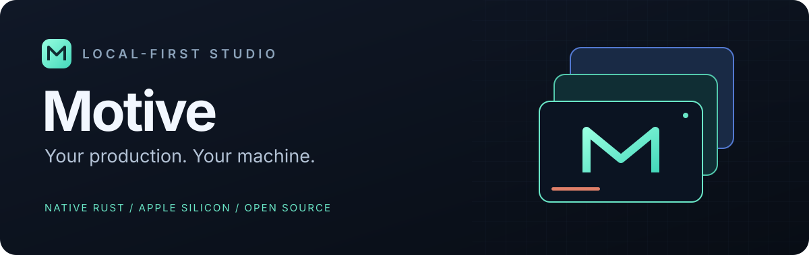

<p align="center">
  
</p>

<p align="center">
  <a href="LICENSE"></a>
  
  
  
</p>

<p align="center">
  A free, open-source production studio for macOS.<br />
  Native controls. Real media. One local engine.
</p>

<p align="center">
  <a href="#-get-started">Get started</a> ·
  <a href="#-one-production-three-controls">CLI & MCP</a> ·
  <a href="#-verification">Verification</a> ·
  <a href="docs/plan.md">Roadmap</a>
</p>

---

Motive is an early native streaming and recording studio built with **Rust, GPUI Kit and libobs**. It brings the interface, command line and AI-agent controls to the **same running production**. No account, hosted backend or subscription is required.

> **Experimental developer preview.** Recording and local loopback streaming work. This is not yet a packaged release or a full replacement for OBS Studio. The current interface is in Spanish; this README is in English.

**Status — November 18, 2026:** H17 has a local release-mode portable B10 candidate; **the beta is not accepted**. H17 fixes unsafe capture admission, stale scene-item references, same-session Show Control reconciliation and observed accessibility feedback defects. B10 rejects a recreated window with zero dimensions, then passes explicit reselection and decoded visual progress in a controlled dual-output run. The external-window focus freeze remains a blocking failure. Output tail delivery, broader recovery, the historical audio-identity failure and distribution gates remain open. GPUI Fast was measured and stays off by default. See the [H17 acceptance matrix](docs/h17-production-reliability.md) and [portable candidate](docs/h17-portable-beta.md). Each result identifies its tested binary; the [B6 checkpoint](docs/h15-resume-verification.md), [H14 results](docs/h14-beta-verification.md) and [H13 results](docs/h13-evidence-index.md) retain their original evidence and limits.

## ✨ What is taking shape

**H21 local report — November 19, 2026:** [C7](docs/h21-c7-verification.md)
completes **three one-hour sessions**: Gaming 1080p60, Podcast and Charlas 1080p30.
All six MKV/loopback recordings pass full decode, cadence and application-reference
A/V checks (worst measured offset 67 ms; worst drift 14.258 ms/hour). C7 separates
admitted-window identity from picker filters and retains C6's safe fallback after
an explicit healthy return. Build, integration, project v1–v6 and shared UI/CLI/MCP
checks were repeated on this candidate. The 1,584 regular bundle files match the
build manifest and its signature verifies; temporary settings and user stores
are restored, with all H21 test processes and sleep assertions closed.

**PERSONAL STREAM READY remains blocked.** Physical camera/microphone hourly
drift is unproven, Spaces and browser capture remain unverified, safe live SCK
reconstruction is restricted, and terminal packet delivery is partial (Charlas
RTMP accounting is inconclusive). Gaming used an instrumented lightweight real
Arkanoid game; Podcast used an owned generated guest application. The first C7
Podcast attempt failed on SCK suspension during a desktop animation; that failure
and all C4–C6 evidence remain. Those three sessions used local receivers; no public release was made.
See the [final acceptance matrix](docs/h21-personal-streaming.md),
[evidence index](docs/evidence/h21/results.json) and
[first stream guide](docs/h21-first-stream.md).

The [supervised follow-up](docs/h21-c7-followup.md) adds another complete Podcast
hour with real beginning/middle/end hand contacts, plus an authorized three-minute
private YouTube trial whose identifier, motion and tone the owner confirmed
remotely. Both hourly files and the private trial MKV decode completely. Physical
drift remains PARTIAL because measurement uncertainty exceeds the 40 ms/hour
budget; the repeated hour retains one clipped microphone block. Spaces still
lacks an observed roundtrip. The unchanged bundle and final cleanup pass again.

**H22 Browser Host laboratory:** native cold replacement, per-generation frame
accounting, an authenticated bounded BGRA channel and an isolated OBS adapter
prepare the H23 handoff. **This does not enable browser overlays in Production.**
Production Keychain and third-party confinement remain blocked. Capacity and
continuity results apply only to the exact owned CEF workloads and binaries;
they do not establish game or streaming performance. See the
[H22 acceptance report](web-host-lab/docs/h22-readiness.md) and
[H23 handoff](web-host-lab/docs/h22-h23-handoff.md).

| | Capability | Implementation |
|---|---|---|
| 🪟 | Screen capture | Explicit Window, Application-on-display and Display through the official OBS ScreenCaptureKit module |
| 📷 | Camera input | Explicit camera selection through the official OBS AVFoundation module |
| 🎙️ | Global audio mixer | Microphone, controlled tone and explicitly selected application or desktop audio; independent gain/mute, peak/RMS and per-input recovery |
| 🎬 | Independent outputs | Concurrent H.264/AAC MKV + loopback RTMP, separate encoder pairs/profiles, stop, duration, errors and recovery per destination |
| 🎨 | Scene editor | Multiple scenes and reusable sources; layer position, size, visibility and order; editable original overlays |
| 🧩 | Overlay engine | Native text, managed images/video, shapes, widgets and original presets; per-layer fade/slide/scale through GPUI, CLI and MCP |
| ↔️ | Production video | 540p, 720p or 1080p composition at 30/60 FPS, landscape/portrait; independent layouts retain their 960 × 540 / 540 × 960 design coordinates |
| 🔌 | Source recovery | Delivery diagnostics, optional safe-scene Cut, bounded failure handling and explicit idle reconnection |
| 🤖 | Agent control | Local MCP and CLI commands, shared state and structured errors |
| 💾 | Project state | Capture modes and safe-scene policy use v6; v1–v5 retain their contracts and stable scene/source/layer IDs |

## 🚀 Get started

You need an Apple Silicon Mac, Xcode with the Metal toolchain, Rust/Cargo and Python 3. FFmpeg/ffprobe are needed for the media verification scripts.

The development environment has been exercised on **macOS 27.2**, Apple M5 Pro, Rust 1.99.1 and Python 3.13.15. The binary targets macOS 15.0+, but that entire OS range has **not** been tested. Allow roughly 4 GB for dependencies and build artifacts.

```sh
git clone https://github.com/luisfarfan/motive.git
cd motive
python3 scripts/bootstrap.py
python3 scripts/bundle.py
open target/Motive.app
```

The bootstrap fetches pinned, checksum-verified **OBS Studio 33.0.1** and its full source tree, plus **SIMDe 0.8.2**, into `.deps/`. It does not install global packages. Cargo.lock pins **GPUI Kit 0.10.0** and its **GPUI 0.3.12** dependency.

**Keep this development app in the checkout.** The command above creates an ad-hoc-signed bundle that links to `.deps/` using local paths. H14 also provides a separate [self-contained app builder](docs/h14-portable-app.md), with dependencies and import tools inside the bundle. Local signed builds have run outside the checkout; notarization and testing on another Mac remain open. No installer or release is published. Launch the bundle rather than `cargo run` so the official muxing helper is in the expected location.

Ad-hoc rebuilds change the code identity and can require macOS permissions again. If you already have a local Apple Development identity, use `python3 scripts/bundle.py --sign-identity "YOUR_EXISTING_IDENTITY"` for a stable development identity. The script never creates certificates or changes the keychain. Close Motive before rebuilding.

### Make your first recording

1. Start with the built-in pattern. For an owned capture fixture, open **Mi producción → Abrir ventana controlada**, then select it from **Añadir fuente → Ventana**.
2. Add a window or webcam from **Añadir fuente**. Use the settings icon beside **Audio** to add a physical microphone or **Añadir tono de prueba**. **Consultar aplicaciones y pantallas** lists system-audio choices. Complete normal macOS permissions and select only content you intend to capture.
3. Check the live preview, channel peak/RMS and master meters. Gain applies on fader release; **Silenciar** keeps the input meter visible while removing its contribution to the master. A suspended window capture needs attention: make the selected window visible and check that its actual content advances before starting outputs. Suspension alone does not identify which macOS window-management feature caused it.
4. Click **Grabar**, then open **Salidas → Grabación MKV → Detener → Confirmar**. Wait until that destination finishes; recordings are saved under `var/recordings/`. **Salidas** shows each destination's status, duration and error. **Perfiles de salida** manages recording/streaming encoding settings; prepare the profiles and loopback receiver before using **Transmitir** alongside recording.
5. While idle, set resolution/FPS in **Preferencias y diagnóstico** and switch **16:9 / 9:16**. Use **Mi producción → Guardar proyecto / Restaurar proyecto guardado** for the composition; use **Guardar mixer / Restaurar mixer** in Audio for its separate store.

Window restoration requires a unique application bundle ID and window title; ambiguous or missing matches need an explicit selection. Camera and microphone selections use device UIDs. No capture device is selected automatically at launch. The global Audio Mixer has its own store (`save_audio_mixer` / `load_audio_mixer`): v1 remains supported; system-audio inputs require v2. Project v3/v4/v5 and output profiles v1 remain separate.

Outputs default to **Apple VideoToolbox hardware H.264** when available, with x264 fallback before each output starts. Recording and RTMP use independent H.264/AAC encoder pairs on the same composition and audio mix. Each destination snapshots its selected encoder/bitrate/CBR/keyframe/reordering profile at start. Resolution/FPS belong to the production and can change only while its resources are idle. `video_capabilities`, `output_capabilities`, `output_profiles` and `outputs` report configuration and observed state. See the [canvas/audio contract](docs/h13-video-audio-contract.md) and [output contract](docs/h13-output-contract.md). A 60 FPS composition does not establish 60 FPS capture: the camera currently requests 720p and keeps its own cadence.

### When a source disappears

The core checks source health once per second, and before commands. Audio Mixer inputs isolate a failed capture and keep the remaining mix/output running until explicit `reconnect_audio_input`; inspect `audio_mixer.issues`. The legacy single-input selector retains the controlled-stop policy described below. A missing window/device, revoked permission or stalled microphone data produces a structured issue. If an output is active, Motive requests a controlled stop and retains the reason. **Reconectar** retries the selected visual sources while idle; it never starts recording automatically. A closed window must be opened and selected again.

Silence is distinct from missing audio packets. Camera health also watches actual incoming frames; a static image is not itself a stall. Recovery is tracked per source, so changing audio cannot acknowledge a failed window. See [scene verification](docs/scene-graph-verification.md) for tested behavior and hardware limits.

### Build a composition

Use **Añadir fuente** to add a window, webcam, overlay or existing source. Select a layer on the canvas or in the layer list; drag, resize or edit its numeric transform. The eye toggles visibility and the layer menu changes order. Command+Z / Shift+Command+Z undo and redo compatible transform edits; a concurrent CLI/MCP change invalidates that local history. Removing a layer does not implicitly delete its shared source; release unused sources from **Añadir fuente → Fuentes sin capas** (the shared `remove_source` command).

The modular native studio includes scene naming and Cut/Fade controls, reusable visual sources, exact layer editing, output-profile management, independent output controls, loopback RTMP configuration, and channel gain/mute with real stereo peak/RMS meters. Light/dark appearance and safe guides have a separate local preference file. Gesture previews commit once on release; revision guards preserve newer MCP changes. See [UI evolution verification](docs/ui-evolution-verification.md), [architecture and capability map](docs/ui-architecture.md), and [editor shortcuts](docs/ui-native-verification.md); H13's executed native workflow and remaining limits are recorded in its [acceptance report](docs/h13-native-acceptance.md).

Geometry, layer order and overlay color can change during recording. Scene selection supports official OBS **Cut and Fade** during recording/local RTMP, with target preparation, shared capture resources and explicit cancellation. Graph edits wait for the transition to finish; adding/removing capture resources and directly changing layer visibility require a stopped output. Each orientation has its own transforms. See [H9 contracts and real verification](docs/h9-scene-transitions-verification.md).

H11 extends the core with text, transparent images, rectangles/circles, local video, countdowns, lower thirds and alerts. Original lower-third, starting-soon and BRB presets include both layouts. Source events and per-layer fade/slide/scale run on the native media clock. Layer animations and scene Cut/Fade are mutually exclusive in this increment. Imported video is visual only: its audio and monitoring stay off. Browser/HTML/JavaScript overlays are unavailable pending isolation and lifecycle work. See the [H11 verification report](docs/h11-overlay-verification.md) for measured behavior and open regressions.

## 🧠 One production, three controls

```text
 Native GPUI interface ─┐
 Local CLI ────────────┼──► Production core ──► libobs ──► Recording / loopback
 MCP stdio adapter ────┘          │                │
                         versioned state      media clock + frames
```

The app owns one engine. CLI and MCP connect to its Unix socket at `var/run/motive.sock` (directory mode `0700`, socket mode `0600`). Commands run on the same main-thread owner. MCP carries control messages and metrics; it does not carry video or drive the media clock.

```sh
./target/debug/motive ctl '{"op":"status"}'
./target/debug/motive ctl '{"op":"devices"}'
./target/debug/motive ctl '{"op":"select_source","window_id":123}'
./target/debug/motive ctl '{"op":"select_camera","id":"CAMERA_UID_FROM_DEVICES"}'
./target/debug/motive ctl '{"op":"select_audio","id":"MICROPHONE_UID_FROM_DEVICES"}'
./target/debug/motive ctl '{"op":"start_recording"}'
./target/debug/motive ctl '{"op":"stop_output"}'
./target/debug/motive ctl '{"op":"reconnect_sources"}'
```

Replace example IDs with values from `devices`. A `null` window ID restores the generated pattern; audio accepts `none`, `tone` or a listed device UID.

The legacy start commands above remain exclusive. Use the H13 destination commands for simultaneous recording and RTMP, after configuring a running, owned loopback receiver:

```sh
./target/debug/motive ctl '{"op":"configure_video","video":{"version":1,"resolution":"full_hd1080","fps":30,"coordinate_space":"design960"}}'
./target/debug/motive ctl '{"op":"configure_stream","endpoint":{"transport":"rtmp","port":19351}}'
./target/debug/motive ctl '{"op":"start_output","target":"recording"}'
./target/debug/motive ctl '{"op":"start_output","target":"streaming"}'
./target/debug/motive ctl '{"op":"outputs"}'
./target/debug/motive ctl '{"op":"stop_output_target","target":"streaming"}'
./target/debug/motive ctl '{"op":"cancel_all_outputs"}'
```

Stopping one destination leaves the other running. Observe each slot's `native_busy: false` before treating it as finished; cancel may wait for a connection worker. `recover_output_target` acknowledges only that destination's failure and never restarts it. Legacy stop/cancel reject two busy outputs with `OUTPUT_TARGET_REQUIRED`. See the [shared contract](docs/h13-output-contract.md) for snapshots, phases and compatibility.

New scene operations use the same core. Read the returned graph to obtain IDs:

```sh
./target/debug/motive ctl '{"op":"add_source","scene_id":"scene-1","name":"Webcam","source":{"kind":"camera","device_id":"CAMERA_UID_FROM_DEVICES"}}'
./target/debug/motive ctl '{"op":"set_transform","scene_id":"scene-1","layer_id":"LAYER_ID_FROM_STATE","variant":"horizontal","transform":{"x":600,"y":48,"width":320,"height":180,"visible":true,"order":2}}'
./target/debug/motive ctl '{"op":"set_overlay_color","source_id":"overlay","color":16739166}'
./target/debug/motive ctl '{"op":"save_project"}'
```

The global Audio Mixer uses the same running core and stays independent of scene Cut/Fade:

```sh
./target/debug/motive ctl '{"op":"add_audio_input","name":"Microphone","source":{"kind":"microphone","device_id":"UID_FROM_DEVICES"}}'
./target/debug/motive ctl '{"op":"add_audio_input","name":"Test tone","source":{"kind":"tone"}}'
./target/debug/motive ctl '{"op":"audio_mixer"}'
./target/debug/motive ctl '{"op":"set_audio_gain","input_id":"ID_FROM_MIXER","gain_db":-12}'
./target/debug/motive ctl '{"op":"set_audio_mute","input_id":"ID_FROM_MIXER","muted":true}'
./target/debug/motive ctl '{"op":"save_audio_mixer"}'
```

Adding the same UID reuses its channel and controls. Gain/mute and individual
recovery work live; adding/removing channels or loading the store requires idle.
Monitoring stays off. Per-input meters are post-fader/pre-manual-mute; the final
mix meter is post-mute and detects saturation before libobs clamps the output.
See the [UI/CLI/MCP contract](docs/h10-audio-ui-contract.md) and
[real audio verification](docs/h10-audio-verification.md).

H13 adds `system_audio_sources` for explicit discovery. Add an application with
`source: {"kind":"system_application","bundle_id":"BUNDLE_ID_FROM_INVENTORY"}`,
or the selectable primary desktop with
`source: {"kind":"system_desktop","display_uuid":"UUID_FROM_INVENTORY"}`.
The same identity reuses its channel. Desktop and application captures cannot
coexist because their audio overlaps. The OBS module requests exclusion of
Motive's own audio; the [controlled B3 exclusion test passes](docs/h14-b3-h13-additional-verification.md), within its recorded display and permission conditions.
Silence with packets is healthy, while `awaiting_audio` reports missing samples. Application
loss remains latched until explicit recovery. See [H13 audio semantics and
limits](docs/h13-video-audio-contract.md).

The H12 GPUI adapter adds **Library → Create / Assets / Presets / Sources** and
a typed inspector with **Content / Live / Animation** tabs. Import files with the
native picker; completion appears only after the core worker confirms its result.
Source properties are shared across scenes; layer transforms remain independent.
See the [H12 integration contract](docs/h12-creative-studio-contract.md) and
[verification report](docs/h12-creative-studio-verification.md) for tested scope
and outstanding acceptance work.

H11 exposes typed overlay definitions and runtime state through that same owner:

```sh
./target/debug/motive ctl '{"op":"overlay_capabilities"}'
./target/debug/motive ctl '{"op":"overlay_state"}'
./target/debug/motive ctl '{"op":"overlay_presets"}'
```

Use the returned IDs and the [overlay integration contract](docs/h11-overlay-ui-contract.md) for complete create/update/event/animation schemas. Import only files explicitly placed in `var/imports`, then pass their basename to `import_asset`; use the returned managed asset ID in definitions. Imports and animations return operation IDs whose terminal state must be observed. GPUI must dispatch these same typed commands; it must not create a second renderer, timer, asset broker or mixer. The [architecture review](docs/h11-architecture-review.md) documents persistence, memory and the same-user security boundary.

H14 connects [Show Control](docs/h14-show-control-contract.md) to the same owner with durable intent, revision receipts, cooldowns and explicit reconciliation. Open **Live Deck** to review and install the original MATCHDAY pack, trigger celebrations/countdowns and change scenes. Save the project and rules separately; restored rules remain disarmed. The [native acceptance report](docs/h14-native-b3-verification.md) separates real rendered results from unconfirmed UI gestures. Optional voice remains an [offline benchmark](docs/h14-voice-offline.md), without live recognition.

Agents control production through CLI/MCP, never by editing project files or automating clicks. Project restoration is explicit after launch with `load_project`.

For an MCP client, use an absolute path to your checkout:

```json
{
  "mcpServers": {
    "motive": {
      "command": "/absolute/path/to/motive/target/debug/motive",
      "args": ["mcp"]
    }
  }
}
```

<details>
<summary><strong>Available MCP tools</strong></summary>

`status` · `devices` · `set_overlay` · `set_variant` · `select_source` · `select_camera` · `select_audio` · `reconnect_sources` · `start_recording` · `stop_output` · `save_project` · `load_project`

`scenes` · `configure_transition` · `cancel_transition` · `create_scene` · `rename_scene` · `remove_scene` · `select_scene` · `add_source` · `remove_source` · `add_layer` · `remove_layer` · `set_transform` · `set_overlay_color` · `reconnect_source` · `snapshot` · `shutdown` · `set_test_window`

`audio_mixer` · `add_audio_input` · `remove_audio_input` · `set_audio_gain` · `set_audio_mute` · `disconnect_audio_input` · `reconnect_audio_input` · `save_audio_mixer` · `load_audio_mixer`

`video_capabilities` · `configure_video` · `system_audio_sources`

`encoders` · `set_encoder`

`output_capabilities` · `output_profiles` · `upsert_output_profile` · `remove_output_profile` · `select_output_profile` · `save_output_profiles` · `load_output_profiles` · `configure_stream` · `preflight_output` · `start_stream` · `recover_output`

`cancel_output` · `request_shutdown` · `credential_status` · `select_stream_credential`

`outputs` · `start_output` · `stop_output_target` · `cancel_output_target` · `recover_output_target` · `cancel_all_outputs`

`overlay_capabilities` · `overlay_state` · `asset_inventory` · `list_assets` · `import_asset` · `remove_asset` · `create_overlay` · `update_overlay` · `overlay_event` · `animate_overlay` · `cancel_overlay_animation` · `overlay_presets` · `instantiate_overlay_preset`

`show_control_status` · `press_show_control` · `cancel_show_control` · `reconcile_show_control` · `save_show_control` · `load_show_control` · `arm_show_control`

`destinations` · `creator_packs` · `memory_diagnostics` · `output_diagnostics`

Responses include the shared PID/revision, source issues and real engine counters. Inputs reject unknown fields. Disconnecting the MCP client leaves the production engine running.

</details>

The API accepts no arbitrary output paths, public stream URLs, shell commands or stream-key values. `configure_stream` accepts only RTMP/RTMPS and an unprivileged port at **127.0.0.1**. `cancel_output` queues safe deferred cancellation (`cancel_pending`) while a handshake finishes; `stop_output` retains its immediate-cancellation guard. Native worker completion is checked through a pinned lifecycle patch to the official OBS output module.

H14 adds a separate [locally approved RTMPS destination registry](docs/h14-destination-contract.md). Host, port and application path are reviewed in GPUI; stream keys enter an AppKit secure sheet and remain in **macOS Keychain**, bound to that destination. Each external start requires a fresh local confirmation; CLI/MCP cannot grant that authority. Private YouTube trials have operator-observed audio/video on [B2](docs/h14-rtmps-b2-verification.md) and the later [C7 follow-up](docs/h21-c7-followup.md), with independent remote decode and numerical remote A/V still unverified. B3 has no external repeat. The [H8 trust limitation](docs/h8-streaming-verification.md) remains historical evidence. The legacy CLI-only `start_local_stream` still sends MPEG-TS to **127.0.0.1:19350**.

Native window close, **Motive → Salir de Motive** and Cmd+Q use the shared shutdown lifecycle. Active production requires confirmation; finalization waits for both output workers and any existing import. The core rejects new work once shutdown is pending or committed while allowing queries. Native tests observed Cmd+Q cancellation, rejection of a stale confirmation and deferred shutdown during an incomplete RTMP handshake. Motive stayed open behind the worker barrier and exited 0.835 seconds after the controlled peer was released. Other native close paths retain their individual coverage in the [acceptance report](docs/h13-native-acceptance.md).

If a forced shutdown leaves a stale socket, first confirm no Motive process remains and `ctl` cannot connect, then remove only `var/run/motive.sock`. Motive never unlinks another running instance's socket.

## 🧪 Verification

We record what ran on real hardware and keep limitations explicit. Build success is not evidence of working media capture.

```sh
cargo test --locked
cargo clippy --locked -- -D warnings
cargo fmt -- --check
python3 scripts/verify_control.py
python3 scripts/verify.py
python3 scripts/verify_scenes.py --camera-id 'YOUR_CAMERA_UID'
python3 scripts/verify_output_recovery.py
python3 scripts/verify_vt_stop.py
python3 scripts/verify_rtmp.py
python3 scripts/verify_rtmps.py
python3 scripts/verify_connect_stop.py
python3 scripts/verify_h8_lifecycle.py
python3 scripts/verify_h8_keychain.py
python3 scripts/verify_profiles_restart.py
```

The integration scripts require the app to be open and idle. `verify.py` also requires the owned test window and normal screen-capture permission. It validates decoded video/audio, source pixels outside the overlay, overlay motion, portrait layout and a loopback receiver. It records for at least 65 seconds.

On portable B3 (`797b9722…04549dc`), **23/23 selected H1–H12 suites pass** with fresh primary reports, zero child exit status, confirmed cleanup and restored stores. The [consolidated audit](docs/h14-b3-regressions-verification.md) verifies hashes and compiled-source identity across three selected runs. It retains the initial scenes path failure and excludes the first H1 take, whose intended tone playback was not established. Neither correction changed B3 or relaxed media checks. These passes do not cover every GPUI workflow or a memory budget; H12's final settling RSS median remains 858.45 MiB. Additional H13 tests have their own results below.

The [additional H13 audit on B3](docs/h14-b3-h13-additional-verification.md) verifies 32 retained original/copy pairs across **nine invocations: 6 PASS, 1 FAIL and 2 INCONCLUSIVE**. Import during shutdown, seven video configurations, four output scenarios, standalone microphone/system mixing, A/V and self-audio exclusion pass. Both shutdown-queue attempts remain inconclusive after TIMEOUT; their owners exited without new recordings. The seven-stage audio sequence remains **FAIL** despite six partial subtrial `ok=true` values. Its [failure audit](var/evidence/h14-system-audio-b3-failure-audit-01/findings.md) locates `APPLICATION_UNAVAILABLE` during tone resumption while the fixture continued producing audio for at least another 16.73 seconds. The exact identity-check condition is unknown; the subtrial checks do not establish continuous application audio. The standalone microphone pass does not replace this failure. The [final native GPUI take](docs/h14-native-b3-verification.md) independently verifies destination recovery, two recorded celebrations, project/mixer restoration and Finder reveal; it retains the unconfirmed rules-save gesture and collector shutdown race.

The [B3 1080p60 lifecycle and 1800.07-second dual-output soak](docs/h14-memory-b3-soak-verification.md) completed with 108057 decoded MKV frames and 108028 locally received RTMP frames. Both full files pass their format, cadence, pixel-freshness and PCM checks. Median CPU was 52.72% of one core; maximum sampled footprint was 1277.03 MiB. The report retains 39 video skips, one lagged render, a visual pause up to 0.601 s and an over-budget memory RPC p95 of 50.88 ms. A later framing analysis locates one missing retained tail video packet per output after stop; it does not establish complete delivery or resolve the encoder-to-observer difference. The original inconclusive analysis is preserved. A/V alignment, allocation ownership and absence of leaks are not established.

[Real GPUI concurrency on B3](docs/h14-ui-concurrency-b3-verification.md) is **PASS for custom3000**: a gain edit during the native animation leaves the job awaiting reconciliation, with no counter increment or replay observed. **Stock450 remains NOT_OBSERVED** because its edit arrived after the animation. All four files decode completely and measure a 12.009–12.014 dB gain step without clipping or interior 100 ms silence. The strict custom geometry check remains **FAIL** for four one-pixel mask-height decreases; its threshold-sensitivity analysis does not turn that result into a pass. Historical failures and these separate scopes remain visible; H14 is not accepted.

H12 has 55 passing Rust tests, clean Clippy and real native workflows decoded from recording and RTMP. The five open H11 regression groups pass on the exact integrated baseline; all 22 suites also pass on their latest H12 runs. Original failures remain preserved, including an intermittent two-frame render-lag failure before the passing final ABBA run. Follow [H12 reproduction and evidence](docs/h12-creative-studio-verification.md) for hashes, CPU/RSS, media and limits. Historical [H11 evidence](docs/h11-overlay-verification.md) is unchanged. Never run physical suites simultaneously in different worktrees.

The historical H13 bundle G (`d9b8d702…e0e2d93`) has 71 passing Rust tests, clean Clippy/format and **23/23 distinct H1–H12 suites passing in their latest runs**. H10 uses [isolated measurement references](docs/h13-h10-metrology.md) and new real recordings; earlier failures and failed manifests remain preserved. The [evidence index](docs/h13-evidence-index.md) maps each result to its bundle and report.

On G, all seven canvas cases and seven system-audio stages pass. Dual outputs pass **4/4 scenarios and 12/12 media**, including independent recovery; two intentionally partial files are distinguished from the ten complete files. Visible A/V passes with seven pulse pairs, median audio−video **+24.27 ms** and a **33 ms range**. This measures end-to-end alignment, not zero latency. H8 shutdown gates and closure during an active import also pass. See [H13 verification](docs/h13-production-verification.md).

Native GPUI production and more than 30 minutes of concurrent recording/RTMP have now been executed. All eight files pass full decoding and strict video cadence checks (maximum interval 34 ms); this is not an overall acceptance pass. The structural analyzer retains seven functional/integrity PASS results, one intentional partial RTMP file as INCONCLUSIVE, and an observed handshake attempt without a media file. The [visual review](var/evidence/h13-native-visual-extract-1794944740966518000/visual-review.md) confirms Cut/Fade, live lower-third edits and countdown controls in both outputs, while retaining two failures: the alert was partly covered by the window, and the window counter stopped advancing in late REC3 samples. The late freeze coincides with window occlusion while the fixture's draw and audio counters keep advancing; its cause remains INCONCLUSIVE.

The separate [compact visual revalidation](var/evidence/h13-native-visual-extract-1794946829324892000/visual-review.md) passes alert legibility after moving its layer to order 3 through GPUI. Window continuity still fails: all 11 periodic samples repeat counter `193356288`. Its two files have [functional and strict-cadence PASS results](var/evidence/h13-native-analysis-1794946801711114000/report.json), while coverage remains INCONCLUSIVE. Terminal accounting is also unresolved: compact RTMP decodes 5027 frames against 5028 reported by the output; MKV matches at 13880. Successful decoding and zero reported drops do not establish delivery of every final frame. See the [native acceptance report](docs/h13-native-acceptance.md) and [production report](docs/h13-production-verification.md).

**H13 remains in progress with partial acceptance.** The latest [self-audio exclusion test passes on the same bundle G](docs/h13-system-audio-exclusion-final.md): −123.174221 dB relative suppression against the unchanged <−45 dB gate, after a controlled floor test passed. The original G failure and its inconclusive attribution remain archived; no code or checker threshold changed, and the near-numerical-floor result is not a universal attenuation guarantee. A directed memory probe observes active malloc allocations returning near baseline while pages remain resident: after releasing the videos and waiting 20 seconds, median RSS is 1141.38 MiB versus 178.41 MiB initially. This is no memory-budget pass or proof about leaks; [memory and encoder-tail measurements](docs/h13-encoder-tail-investigation.md) retain the limits and nonuniform final video intervals from earlier runs.

See [H1 verification](docs/h1-verification.md) and [scene-graph verification](docs/scene-graph-verification.md) for device tests, recovery behavior, prerequisites and evidence. The output-recovery test deliberately terminates only Motive's own mux helper. Captures, device inventories and runtime logs stay under ignored `var/`; they are not published with this repository.

## 🗺️ Direction and boundaries

- **Now:** portable B3 has 23/23 H1–H12 regression passes, nine additional H13 invocations (6 PASS, 1 FAIL, 2 INCONCLUSIVE), a complete 30-minute dual-output soak and real Show Control/GPUI evidence. The final native workflow and its three media files have been analyzed. Custom3000 concurrency passes; stock450 remains unobserved and the strict custom geometry failure is retained. The beta is not accepted.
- **Next:** investigate application-audio and capture/cadence failures, resolve shutdown-queue coverage, output accounting and memory limits, and complete portability, accessibility and removable-device recovery checks. Private RTMPS has operator observations on B2 and C7; independent remote decoded delivery and a B3 external repeat remain unverified.
- **Later:** isolated browser overlays, richer typography/effects, a notarized distributable release and simultaneous variants. No release or public broadcast is authorized by these local tests.

The preview copies new BGRA frames through CPU memory into GPUI; it is not zero-copy. The core supports up to 8 scenes, 16 visual sources, 32 layers and 4 video sources, with one active canvas, one MKV destination and one RTMP destination. It does not provide multiple streaming destinations or simultaneous canvas variants. The 256 MiB visual allocation estimate is not an RSS cap: hidden decoders and resource-replacement peaks still consume memory. There are no cloud services, payments or marketplace features.

Competitive research prioritizes official documentation, open-source code and observable behavior. REA is optional research tooling, **never a product dependency**. Motive's design and implementation are independent; no proprietary Meld code, assets or designs are included.

## 🛠️ Contributing

Start with [AGENTS.md](AGENTS.md), [the plan](docs/plan.md) and [architecture decisions](docs/decisions.md). Project notes are currently in Spanish. Keep changes focused and include reproducible evidence for media behavior. Never commit recordings, device inventories, stream keys or downloaded SDK bundles.

| Directory | Responsibility |
|---|---|
| `src/main.rs` | Application startup and CLI/MCP dispatch |
| `src/ui/` | Native studio, theme, components and guarded canvas editor |
| `src/core.rs` | Shared commands, health policy and project state |
| `src/audio.rs` | Typed global audio registry, microphone/system identities, meter/health contracts and v1/v2 persistence validation |
| `src/video.rs` | Production resolution/FPS contract and stable design-coordinate mapping |
| `src/overlays/` | Typed definitions, managed imports, widgets/presets and shared overlay controls |
| `src/output.rs`, `src/output_runtime.rs` | Independent destination registry, lifecycle, profile snapshots and loopback endpoint validation |
| `src/scene.rs` | Stable scene graph, independent layouts and validation |
| `src/control.rs` | Local socket, CLI and MCP adapter |
| `src/engine.rs` | Main-thread Rust ownership of the native engine |
| `native/engine.m` | libobs, ScreenCaptureKit and AVFoundation integration |
| `native/output-slots.inc` | Independent OBS outputs/encoders, metrics and native worker barriers |
| `native/graph.inc` | Native scenes, source reconciliation and camera frame health |
| `native/overlays/` | OBS source wrappers, widget clocks and per-layer animation lifecycle |
| `scripts/` | Pinned bootstrap, bundle and real-media checks |

## 💚 Built on open source

Motive is licensed under **[GPL-3.0-or-later](LICENSE)**. It builds on [OBS Studio](https://github.com/obsproject/obs-studio), [GPUI Kit](https://github.com/longbridge/gpui-kit) and their communities. Third-party code retains its own licenses; see [third-party notes](docs/third-party.md).

<p align="center"><sub>Made for creators who want their production to stay on their machine.</sub></p>
