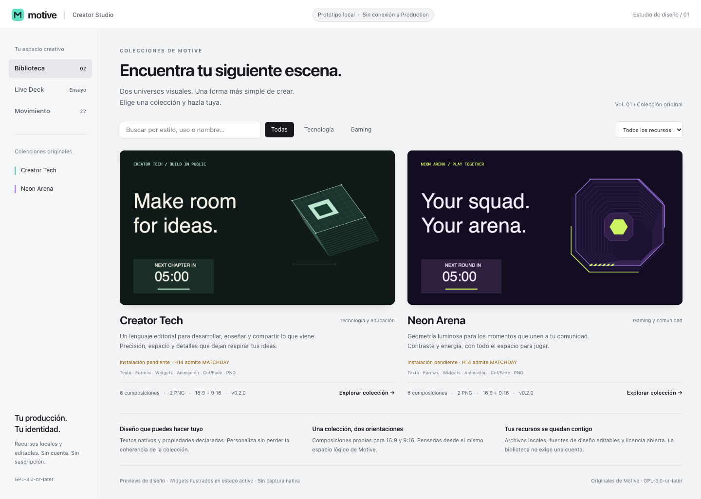

# Motive · Creator Experience

Dos colecciones originales v0.2.0 con recursos editables, manifests v1 validados,
Motion System y un prototipo independiente de biblioteca, personalización,
instalación y Live Deck. La [matriz de aceptación](docs/acceptance-matrix.md)
relaciona cada sección del pedido con sus entregables y evidencia.



## Explorar

Desde el worktree de esta entrega:

```sh
python3 creator-experience/prototype/serve.py --port 8768
```

Abrir `http://127.0.0.1:8768/prototype/`. Es un servidor estático en loopback,
sin dependencias de red. Ctrl+C lo detiene. El prototipo permite buscar, revisar
colecciones, editar propiedades, descargar un manifest, comprobar un plan y
ensayar el Deck, las 22 animaciones y siete estados visuales de instalación.
Todo ensayo está identificado como independiente
de Production. No instala ni controla Motive.

| Colección | Composiciones | Fuentes / capas | Animaciones | Propiedades | Assets PNG |
|---|---:|---:|---:|---:|---:|
| [CREATOR TECH](packs/creator-tech/README.md) | 6 × 2 orientaciones | 12 / 27 | 10 | 12 | 2 |
| [NEON ARENA](packs/neon-arena/README.md) | 6 × 2 orientaciones | 12 / 27 | 12 | 12 | 2 |

Ambos incluyen Starting Soon, cámara, pausa y cierre; TECH añade Live Coding y
presentación, ARENA gameplay y comunidad. Cuatro PNG alpha, sus SVG editables,
24 previews de composición, cuatro de alerta y dos contact sheets. Texto y
widgets permanecen nativos/editables; las capturas son recetas de selección
posterior. Sin assets propietarios ni fuentes redistribuidas.

## Entregables y alcance

| Entrega | Estado comprobado |
|---|---|
| Arte, manifests, ambas orientaciones, properties, reglas y Deck | Implementados y validados offline |
| [Motion System](motion/README.md) | 22 previews seleccionables, parámetros acotados, ambas orientaciones, reducción y transición BRB |
| Biblioteca, personalizador, plan y Live Deck | Prototipo funcional: color/texto/estilo/variantes, siete fixtures de instalación y recuperación |
| [Autoría por agentes](agent-authoring/README.md) | Workflow y ejemplo reproducible de podcast con dos cámaras reservadas, lower thirds y pausa |
| [`.motivepack`](docs/motivepack-proposal.md) | Propuesta versionada y ejemplos de metadatos/checksums calculados sobre los recursos reales |
| [Marketplace](marketplace-concept/README.md) y [extracción](docs/repository-extraction-plan.md) | Arquitectura y roadmap; sin backend ni repositorios nuevos |
| GPUI, importación oficial, bindings y aceptación audiovisual | Integración futura, excluida expresamente de este pedido |

El instalador H14 observado solo incorpora MATCHDAY y rechaza recursos externos.
El prototipo rotula sus estados «instalando» e «instalado» como ejemplos visuales;
no ejecuta un instalador ni crea entidades en Motive. `.motivepack` sigue siendo
una especificación; no se emitió un ZIP certificado ni un instalador paralelo.

Dos packs completos **no caben juntos** bajo el límite global de ocho escenas.
Las cuotas también deben sumar el proyecto existente y las capturas elegidas.
Cada pack aislado deja dos escenas, cuatro fuentes y cinco capas; no constituye
reserva garantizada en un proyecto ocupado.

## Evidencia y reproducción

```sh
python3 creator-experience/validation/validate.py
python3 creator-experience/validation/test_validation.py
python3 creator-experience/packs/tools/generate.py
python3 creator-experience/motion/build_catalogue.py
python3 creator-experience/agent-authoring/verify_example.py
python3 creator-experience/docs/motivepack-examples/build_examples.py
```

Python stdlib; generación raster con Swift/AppKit de macOS; contratos con Cargo
offline/locked y el crate real de Show Control. Ver [validación](validation/README.md)
y [generador](packs/tools/README.md). Nada enlaza ni ejecuta el motor de Motive.

- [Auditoría](docs/audit.md): fuentes, límites, presupuestos y hashes.
- [Informe final](docs/final-compatibility.md): resultados y pendientes de H14.
- [QA visual](design-qa.md): capturas, iteraciones y límites.
- [Validación de contenido](evidence/contracts-validation.json) y
  [compatibilidad H14](evidence/contracts-h14-snapshot.json).
- [QA del cierre](evidence/completion-browser.json): 213 comprobaciones nuevas,
  más [69 de regresión](evidence/completion-regression.json), todas PASS.
- [Ejemplo de autoría](docs/authoring-example.md) y
  [ejemplos de distribución](docs/motivepack-examples/README.md).
- [TECH · contact sheet](packs/creator-tech/previews/contact-sheet.png) y
  [ARENA · contact sheet](packs/neon-arena/previews/contact-sheet.png).

Previews propios y screenshots de HTML son evidencia de diseño, **nunca de
grabación nativa**. Se conservan fallos iniciales en `evidence/` y se documentan
las correcciones. Sin push, merge, rebase, release, lock físico ni escritura en H14.

Todos los archivos de entrega están bajo `creator-experience/` en la rama
`codex/creator-experience`. [GPL-3.0-or-later](LICENSE), incluido el código de
autoría y los recursos originales. No se creó un repositorio independiente.
