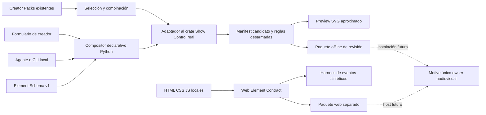

# Arquitectura de Element Lab

La autoría produce datos revisables. Un único Motive futuro seguirá siendo
propietario de Production, libobs, IDs, assets, reloj y salidas. Este laboratorio
no se conecta a esa instancia ni inicia la aplicación.

## Componentes ejecutados

- `sdk/common.py`: lectura acotada de archivos, JSON y validación estructural.
- `sdk/compiler.py`: DAG, properties, referencias, namespace, recursos y lowering
  hacia CreatorPack v1; no dibuja frames.
- `sdk/modular.py`: cierre de dependencias por escenas/fuentes; remueve reglas
  incompatibles enteras con informe; mezcla explícita dentro de cuotas.
- `sdk/contract-validator`: crate independiente con dependencia de solo lectura
  a `show-control/`; parsers, plan, preparación de acciones y ensayo simulado real.
- `sdk/preview.py`: SVG estático de geometría; widgets esquemáticos. No reproduce
  las fuentes, animaciones ni píxeles del renderer de Motive.
- `sdk/server.py`: servidor loopback para el formulario y el ejemplo web propio.
  Sus endpoints usan el mismo compositor y empaquetador.
- `web-elements/runtime-prototype`: API visual de prueba, validación de mensajes,
  Promise/AbortSignal, lifecycle y controles; no implementa Show Control.
- `sdk/packaging.py` / `catalog.py`: revisión reproducible y catálogo local sin
  backend, identidad verificada, instalación, cuentas o conectividad cloud.

## Una autoridad por contrato

El schema de elementos conserva el vocabulario nativo como subcontrato; no copia
los enums Rust. Después del lowering, el crate real verifica CreatorPack y Config,
referencias y `actions::prepare`. El snapshot es deliberadamente hipotético:
valida coherencia, no el estado real del estudio. `pack.plan` sigue declarando
`executable:false`. El ensayo acepta únicamente eventos simulados y no tiene
transporte vivo. No hay segundo MCP ni scheduler audiovisual.

La selección modular usa copias en memoria. Namespacea IDs y triggers manuales o
custom, conserva geometría H/V y muestra los remapeos. No transporta variables,
Decks ni acciones de control no visual sin una política de migración. Los packs
de origen no se editan. Un límite excedido es error, no truncamiento.

## Presupuestos y confianza

El SDK comprueba 8 escenas / 16 fuentes / 32 capas, 4 videos y la estimación de
256 MiB. El informe separa la heurística CreatorPack de la estimación H11, más
conservadora; ninguna mide memoria del proceso. `--occupied` incorpora un
snapshot aportado por el autor, nunca una reserva en Production. La instalación
futura debe repetir estos gates contra la revisión vigente del owner.

Los recursos se leen relativos a un directorio autorizado, sin symlinks/hardlinks,
con tamaño/hash y validación PNG. El empaquetador no ejecuta contenido y verifica
inventario completo antes del staging temporal de contenido web para revisión.
Un hash comprueba integridad; autor y licencia siguen siendo declaraciones.

El iframe de prueba usa origen opaco, CSP y MessageChannel. Esto sí impide los
intentos concretos registrados en el navegador, pero no constituye un host
seguro para terceros ni limita CPU/GPU/RSS. `requested_fps` no es el reloj de
libobs. El host nativo está separado y pendiente de los gates de
[integración](integration-contract.md).

## Autoría sin código y con código

El formulario permite escoger cualquiera de cuatro bases, editar properties,
validar, ver H/V y descargar el paquete nativo. La composición avanzada se hace
por CLI/JSON. No se implementó un editor libre de arrastrar capas.
Un desarrollador web edita archivos locales y recibe eventos visuales tipados.
Un agente consume exactamente la CLI y los mismos schemas. Ninguna de estas
experiencias necesita modificar Rust para cada diseño.
