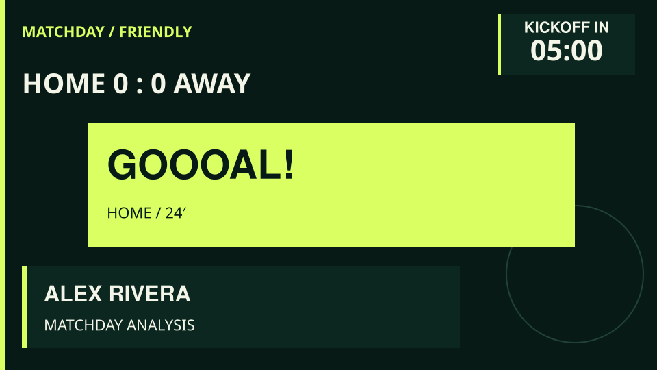

# Motive Show Control

**Local events. Typed rules. Inspectable action plans.**

An independent Rust control module built against Motive's verified H12 contracts.
It runs without GPUI, libobs, devices, provider accounts or the Motive application.
All executable examples are **simulations**. No live Production adapter ships here.



## Try it

From the repository root:

```sh
cargo run --locked --manifest-path show-control/Cargo.toml -- simulate goal
cargo run --locked --manifest-path show-control/Cargo.toml -- simulate donation
cargo run --locked --manifest-path show-control/Cargo.toml -- simulate chat
cargo run --locked --manifest-path show-control/Cargo.toml -- simulate burst
```

The goal scenario selects a rule, prepares an existing widget's `overlay_event`,
records sound as unavailable, increments a local counter, rejects a duplicate and
blocks a second trigger on cooldown. Output labels every plan as simulated and
reports `live_commands_sent: 0`; it does not claim that OBS displayed anything.

Load editable definitions and connect their symbolic targets to a pack fixture:

```sh
cargo run --locked --manifest-path show-control/Cargo.toml -- run \
  show-control/examples/rules/matchday.json \
  show-control/examples/events/goal.jsonl \
  show-control/examples/packs/matchday.json

cargo run --locked --manifest-path show-control/Cargo.toml -- plan-pack \
  show-control/examples/packs/matchday.json

cargo run --locked --manifest-path show-control/Cargo.toml -- deck-press \
  show-control/examples/decks/matchday.json \
  show-control/examples/packs/matchday.json brb --confirm
```

`--confirm` rehearses a local sensitive-button confirmation. It is not a live
authorization token. `validate-event`, `validate-config`, `validate-pack` and
`example-config` are also available. Errors use `{ok:false,error:{code,message}}`
on stderr with exit status 1. A valid simulation report can contain rejected jobs;
inspect admissions, decisions and job outcomes rather than assuming exit 0 means
every requested action succeeded.

## What runs today

| Component | Implemented behavior |
|---|---|
| Event model | Version 1, 13 closed event kinds, validated payloads, stable IDs, correlation, provider IDs and explicit simulation marker |
| Rules | Typed equality, numeric/phrase checks, variables/counters, trust, confidence provenance, production context and shared cooldowns |
| Scheduling | Bounded priority/FIFO admission, rate limits, leading-edge debounce, cooldown, dedup, cancellation, deadlines and cycle/action budgets |
| Action preparation | Existing-source events, countdowns, complete text replacement, layer animations/cancellation and Cut/Fade command plans |
| Lifecycle | Validated/prepared/sent/accepted/observed completion concepts, uncertainty and explicit reconciliation without automatic mutation retries |
| Local state | Typed counters, inert notices/speech preparation, versioned checkpoints and conservative restart without replay |
| Live Deck | Groups, order, icons, shortcuts, cooldown, pending/confirmation/history states and eight CLI-tested example buttons |
| Creator Packs | Strict declarative validation, typed customization, capability gaps and proposed install plans with `executable:false` |
| Provider boundary | Synthetic authorized ingress and exact integer donation normalization; real providers remain unavailable |

The schemas are the Rust serde contracts with `deny_unknown_fields` and explicit
semantic validators, exercised by the CLI and malformed-input tests. There is no
separate permissive JSON schema, raw MCP escape hatch or expression interpreter.
Rules/configuration/checkpoints are separate from Motive project v3/v4, mixer and
output profiles. Only this directory and its own Cargo manifest/lockfile change.

## Deterministic policies

- Higher priority runs first; equal priority preserves admission order. Each tick
  advances at most one action per ready job. Accepted asynchronous work waits for
  observation before the next sequence step. The clock never advances media.
- Queue capacity is configurable from 1–256 jobs. Admission of an event's selected
  rules is atomic. Unresolved dispatched jobs still occupy capacity. Shared cooldown
  reservations use priority then rule-definition order within a single event.
- Debounce suppresses subsequent events during a fixed window; it does not delay
  the first event or implement trailing-edge text aggregation. Cooldowns begin on
  admission, including jobs later cancelled. Strict provider timestamp regression
  is rejected; wall timestamps never determine scheduling deadlines.
- There are at most 64 rules, 16 conditions per rule, 32 leaf actions per rule,
  four nested sequence levels and eight internal rule hops. A correlated root has
  a separate total action budget. Recursion cannot reset that budget.
- The dedup journal holds 8,192 keys and the correlation journal 4,096 roots.
  Exhaustion fails closed; there is no silent eviction. Start a new session only
  deliberately. Rejected full/rate/out-of-order events remain consumed.
- Default sequences stop on a failed required action, preserving earlier effects.
  `continue_unavailable` skips only unavailable capabilities, with a visible record.
- `Runtime::checkpoint` / `Runtime::restore` preserve consumed IDs, counters and
  remaining cooldowns. Pending unsent steps become cancelled; accepted work becomes
  `needs_reconciliation`. There is a documented draft-v0 migration fixture, unrelated
  to Motive's project schema. Checkpoints are explicit snapshots, not an automatic
  crash-safe write-ahead journal or an exactly-once guarantee.
- Original PID/revision remain fixed across a sequence. Even a successful native
  step must not silently rebase the next step onto unrelated edits. A future owner
  receipt contract is required for live continuation after a revision change.

## Collections and evidence

MATCHDAY includes four proposed scenes, twelve shared overlays, twenty-three layers
and six animation definitions in horizontal/vertical layouts. Its football clock
uses the existing countdown; automatic score data and count-up are unavailable.
CREATOR TECH and NEON ARENA are smaller coherent concepts. All use original text,
shapes and native widget definitions; no third-party media assets are required.

Open [the independent visual prototype](design/index.html) to inspect the original
collections and rehearse Deck interactions. That HTML is a presentation study,
not the Rust runtime, GPUI implementation or an importable browser overlay.

```sh
python3 show-control/verify.py
```

The verifier runs all Rust tests, Clippy, format, CLI scenarios, example schema
validation, pack planning and Deck presses. It records source hashes and command
results in [evidence/verification.json](evidence/verification.json).

- [Verification and exact limits](docs/verification.md)
- [Creator Pack format and original designs](docs/packs.md)
- [Live Deck component/integration contract](docs/live-deck.md)
- [Security review and retained regressions](docs/security.md)
- [Official competitive research and voice/provider roadmaps](docs/research.md)
- [Future adapter onto the one Production owner](docs/integration.md)

Next: review H13's stable contracts, then integrate a narrowly armed owner-side
adapter for existing-source events and a single Cut/Fade. Verify real recording
and local RTMP before voice, platform events, soundboard, TTS or pack installation.

GPL-3.0-or-later, matching Motive. No push, merge, release or public broadcast is
part of this increment.
