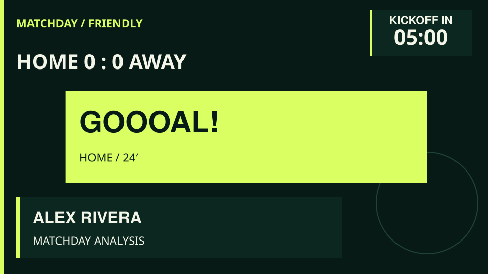

# Creator Packs v1 — offline definitions and proposed plans

Implemented in the independent `show-control` crate; no production importer exists.
`CreatorPack::from_json` performs strict schema/semantic validation. `plan` produces
bounded typed proposed steps with **`executable: false`**. It never accesses a file,
opens a socket, creates an OBS source, starts a timer or dispatches an animation.

The normative schema is `src/packs.rs`: serde enums plus `deny_unknown_fields`,
version 1, mandatory fields and semantic checks. Unknown versions, unknown members,
malformed input and manifests above 256 KiB are rejected. The three JSON examples
are tested against this implementation. No permissive raw MCP/JSON command field,
script field, embedded executable code, credentials, automatic URL fetch or plugin
installation exists.

## Original collections

| Collection | Scenes | Reusable sources | Total layers | Defined animations | Status |
|---|---:|---:|---:|---:|---|
| MATCHDAY | 4 | 12 | 23 | 6 | Detailed original declarative collection |
| CREATOR TECH | 2 | 7 | 9 | 2 | Smaller structural/visual concept |
| NEON ARENA | 2 | 7 | 9 | 2 | Smaller structural/visual concept |

All layers define independent horizontal 960×540 and vertical 540×960 layouts.
All examples use system font names, shapes and current native widget contracts;
none requires a downloaded image, video, commercial logo or font. Authored content
is GPL-3.0-or-later, matching Motive. The figures below and JSON fixtures are original,
not copies of broadcast packages, Meld or Claude Design files.

MATCHDAY includes goal alert, editable scoreboard text, production countdown,
sport presenter lower third, Starting Soon, Half-time/BRB, Ending, a community alert
and simple touchline/circle decoration. Its goal entry/exit are scale animations;
presenter entry/exit are slides; starting title uses fades. It deliberately leaves
room below the 8-scene/16-source/32-layer limits for an eventual capture composition.
Those are whole-production limits: a future importer must account for the existing
graph, rather than assuming that every validated pack fits a nonempty project.



The `match-clock` is an existing **countdown**, shared by starting/live scenes.
Changing scene does not reset it. Football count-up and live score data are not
supported here. The safe alternative is the countdown plus explicit typed edits to
`scoreboard` text. Camera outlines in the two smaller concepts are shape placeholders,
not capture sources. Sound, TTS, browser overlays, voice detection and real platform
events remain unavailable. The synthetic voice example tests rule processing only.

The fixture uses rule references `goal-celebration`, `donation-alert` and
`brb-authorized`. Their event conditions live in the separate Show Control rule
configuration, keeping pack composition data distinct from runtime configuration.
The manual Deck has explicit `deck-goal`, `deck-community` and `deck-celebrate` rules;
a button cannot impersonate a trusted voice/chat event to bypass its conditions.
Binding these rule IDs, targets and capabilities is part of simulator/integration
preflight, never an automatic provider connection or action at pack load.

## Validation and capabilities

Pack scope: 1–8 scenes, 1–16 overlays, at most 32 layers, 64 animations, 64 properties,
16 media descriptors, 32 event kinds and 64 rule references. Scene, source and layer
symbols are unique; references must resolve. Native names use the existing 80-character
nonempty/no-controls limit. Text, font, RGB24 colors, opacity, widget duration, geometry,
source dimensions and animation parameters mirror the H11/H12 contracts. Scene
transitions remain H9 Cut/100–5000ms Fade; layer animations allow 100–10000ms. They
are different contracts.

A declared capability set is required. `Capability::h12_contracts()` describes the
read-only H12 contract baseline, not detected runtime availability. The output plan
lists unavailable capabilities explicitly. `soundboard`, `tts`, `browser_source`
and `voice_recognition` can be requested but are never silently treated as available.
The pack cannot introduce new capabilities merely by declaring them.

Media descriptors accept only safe inbox basenames and declared PNG/JPEG/WebP or
MP4/MOV/WebM types with bounded dimensions, byte sizes, duration and SHA-256 metadata.
Paths, URL schemes, separators, dot prefixes, traversal, SVG/HTML/scripts and unknown
fields fail. No file is opened by validation, so these declarations do **not** prove
media decode safety, hashes, duration, codec, authorization or existence. A future
locally authorized staging step and Motive's actual importer must verify the bytes.
Plans mark this as `import_asset_after_local_authorization`, not a command already
ready to execute. The supplied examples contain zero media resources.

The 256 MiB texture ceiling is enforced against a planning heuristic (dimensions,
RGBA storage and per-kind multiplier). It is not a verified upper bound on native
RSS, atlas allocation or decoder usage; production must perform its own budgeting.

## Typed customization and planning

`set_property(id, PropertyValue)` edits only a typed target: text content, widget
title/subtitle, or shape color. It validates a candidate copy and commits only on
success. Invalid type, UTF-8/control content, size or geometry leaves the pack intact.

Plans propose existing `create_scene`, `create_overlay`, `add_layer` and
`set_transform` concepts. A `create_overlay` result creates a first layer; the adapter
must retrieve and bind its returned ID instead of adding an accidental duplicate.
Repeated source symbols generate `add_layer` proposals to reuse the source. Each
layer gets both transforms. IDs remain symbols until actual command replies bind
them. The plan is neither a project-v4 serializer nor a transactional importer.
No live import, rollback, animation registration or mutation replay is claimed.

Future integration requires idle/owner preflight, explicit local approval of resource
staging and plan, graph/capacity checks, actual returned IDs, current capabilities,
owner-side revision checking, and failure reconciliation without uncertain retries.
Do not start rule execution until installation and target binding are verified.

## Design study and reproduction

`design/index.html` is a self-contained interaction study. It has a visible
**SIMULATED DESIGN PROTOTYPE / NO LIVE CONNECTION** label, separate intent previews
and local confirmation rehearsal. It has no backend, fetch, Production, device,
provider or sound connection. The Rust CLI is the functional deterministic simulator;
clicking the HTML page is only a presentation exercise, not engine execution.

SVG previews are generated from fixtures by:

```sh
python3 show-control/design/render_preview.py
cargo test --manifest-path show-control/Cargo.toml --test packs --test deck
```

The generator approximates layout/font rendering, widget state and typography.
Exact FreeType/native rendering still needs a later authorized integration test.
HTML/SVG are documentation and are **not importable H12 pack resources**.

Visual checks on 2026-11-17 used only proxima-browser, a temporary server bound to
127.0.0.1 and no Motive instance. Desktop 1440px and mobile 390px: no horizontal
overflow, all seven displayed previews decoded, zero console errors/warnings and
no external resource requests. Goal rehearsal, confirmation/cancel and disabled sound
were exercised. Browser screenshots are `design/preview-desktop.png` and
`design/preview-mobile.png`. The temporary preview server was stopped afterward.
