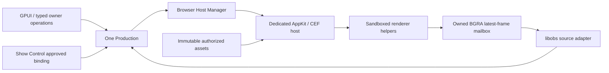

# Host architecture — checkpoint C

Decision: CEF directly, reusing its runtime/wrapper and OBS Browser integration
patterns. No complete fork. Current prototype implements contracts independently;
native and Production wiring are separate, unaccepted layers.

Motive's manager has instance ID, monotonic generation, contract, viewport epoch,
lifecycle and health. It owns approval and binding; a JSON field cannot grant
authority. A separate host has no Production pointer, socket path, credentials,
device handles or inherited environment beyond an explicit launch allowlist.
Manager-created private channels are capabilities, not user-selected endpoints.

The native host runs its own AppKit main thread and CEF loop. Use the pinned
cefsimple macOS NSApplication/CefAppProtocol, scoped event handling, loader and
final-close pattern. No Qt, libobs or GPUI linked into the browser executable.
Process lifetime is host lifetime: do not repeatedly CefInitialize/CefShutdown
inside a reused host process. A restart gets a new process and generation.

Control admission: bounded frame length → typed decoding → channel identity and
generation → monotonic sequence → deadline → rate → contract allowlists → lifecycle.
Control and frame channels are separate. Reserve an independent control lane for
cancel/dispose so a full data/event queue cannot delay cleanup. A slow or compromised
renderer cannot serve as its own watchdog. Host and manager also have bounded work.

Frames: BGRA8 premultiplied, upper-left, tightly packed, fixed sRGB target pending
color validation. Copy all pixels inside OnPaint; never store its pointer. Dirty
rectangles are validated metadata, not deltas: coalescing deltas would lose edits.
Single latest pending frame plus at most one consumer-owned frame, no history.
Frame index counts validated observed paints, observation time is monotonic health
telemetry only. Production chooses whether to repeat/drop under its existing tick.
Resize invalidates the pending slot and increments viewport epoch; crash/dispose
invalidates generation and releases resources. An old callback cannot relabel
itself as new merely by reading a mutable current generation.

First prototype recreation on resize is allowed: fresh browser/session identity
avoids A→B→A delayed-paint ambiguity that dimensions alone cannot resolve. A later
WasResized optimization needs a verified CEF barrier; it is not implied by a new
width/height. No zero-copy, async AV source clock or renderer-driven production.

Lifecycle: created → ready → active → ready; hidden cancels and rejects work;
explicit resume; suspend closes browser and drops frames; close waits for final
callback; disposed never resumes. Crash/timeout moves to failed, drops data and
requires explicit restart/new generation. No replay of event that might have run.

Validation at C: compared proposal against existing Element Lab lifecycle,
Production ownership decisions D9–D12 and current OBS/CEF sources. Runtime
coordination and process supervisor remain NOT_EVALUATED.

